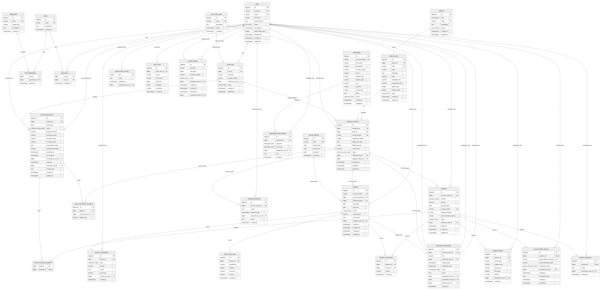

# Technical Documentation

BCIS Subscription Billing and Collection System — deliverable D3 of the
laboratory specification. This document covers requirements traceability,
architecture, modules, the data model and data dictionary, API and IPC
design, the security model, and backup/restore. Installation and LAN set-up
are in `deployment-guide.md`; day-to-day operation is in `user-manual.md`;
test evidence is in `tests/acceptance-test-report.md`.

## 1. Requirements summary and traceability

Bukidnon Cable and Internet Services needs a Windows desktop system used
simultaneously from three office PCs to manage Internet, Cable and Combo
subscriptions, monthly billing, subscriber ledgers, Cash/GCash collection,
house-to-house collectors, overdue receivables, management reports, audit
trails and backup/restore.

| Spec | Requirement | Where it is implemented |
|---|---|---|
| 2.1, 2.3 | Client–server; renderer never reaches PostgreSQL | `desktop/src/preload`, `desktop/src/main` (IPC → HTTP); ESLint `no-restricted-imports` |
| 2.3 | Integer centavos, transactions, migrations | `api/src/lib/money.ts`; `db.transaction` in every posting route; `api/drizzle/*.sql` |
| 3.1, 4.4 | Roles and granular permissions, server-side | `api/src/lib/permissions.ts`, `requirePermission(...)` on every route |
| 3.2 | Subscribers, multiple service accounts, global search, no deletion | `routes/subscribers.ts`, `routes/search.ts`; `DELETE /subscribers/:id` → 405 |
| 3.3 | Plans (code, fees, speed, channels); account rate, due day, start date | `routes/services.ts`, `routes/service-accounts.ts` |
| 3.4 | Monthly billing run, DRAFT…CREDITED states, void/adjust, no duplicates | `routes/billing-periods.ts` (`/generate`), `routes/invoices.ts`, `lib/invoice-status.ts` |
| 3.5 | Ledger with running balance; Statement of Account for a date range | `computeLedger()` / `statementForRange()` in `routes/reports.ts` |
| 3.6 | Cash/GCash/Bank/Cheque/Other; exact, partial, advance; oldest-first; reversal | `routes/payments.ts` |
| 3.7 | GCash proof review; duplicate references; verify/reject audit | `routes/payments.ts`, `routes/payment-proofs.ts` |
| 3.8 | Areas/routes, route sheets, batch lifecycle, cash reconciliation | `routes/collections.ts`, `routes/collection-batches.ts` |
| 3.9 | AR dashboard totals, aging, overdue list, filters | `routes/receivables.ts`, `lib/receivables.ts`, dashboard |
| 3.10 | Grace period/threshold settings, suspension, reconnection workflow | `routes/settings.ts`, `routes/service-accounts.ts` |
| 3.11 | Receipts never reused; all management reports; PDF/XLSX | `receipt_number_seq`; `routes/management-reports.ts`, `routes/reports.ts` |
| 4.1–4.3 | Design tokens, navigation tree, screen requirements | `desktop/src/renderer/src/index.css`, `lib/roles.ts`, components |
| 4.4 | Audit, proof validation, lockout, session lock | `audit_logs`; `lib/attachments.ts`; `routes/auth.ts`; `auth-context.tsx` |
| 4.5 | Indexes, pagination, transactions, backup incl. attachments | schema indexes; `lib/backup.ts` |
| 7 | AT-01…AT-12 | `tests/acceptance-test-report.md` |

## 2. Architecture

```
PC 1: Owner/Admin Desktop   ─┐
PC 2: Cashier Desktop        ├── LAN ──> BCIS API Server ──> PostgreSQL
PC 3: Operations Desktop    ─┘                │
                                               ├── Attachments  (ATTACHMENTS_DIR: payment proofs)
                                               ├── Backups      (BACKUP_DIR: pg_dump + attachment mirror)
                                               └── Audit / Logs (audit_logs table, pino JSON logs)
```

- **Desktop clients** — Electron 44, electron-vite, React 19, TypeScript
  strict, Tailwind CSS 4, TanStack Query. The client renders data and calls
  the API. It never computes authoritative money, never decides
  authorization and never touches PostgreSQL. Each PC sets the server address
  once on the login screen (health-checked, remembered per PC).
- **API server** — Fastify 5, Zod 4, Drizzle ORM. All business rules (money,
  allocation, invoice state, permissions, auditing) live here and apply
  identically whichever client — or a direct HTTP call — triggers them.
- **Database** — one PostgreSQL instance. A shared SQLite file cannot give
  three PCs row locking, transactional posting and consistent numbering;
  PostgreSQL does (`SELECT … FOR UPDATE` on the service account serialises
  concurrent payments; sequences give unique invoice/receipt numbers).

### Electron process boundary

- `contextIsolation: true`, `nodeIntegration: false`.
- The renderer sees only `window.bcis.*` (`desktop/src/preload/index.ts`),
  backed by named `ipcMain.handle` channels in `desktop/src/main/index.ts`.
- The JWT lives only in the main process (`electron-store` +
  `safeStorage`). File access (proof upload, report save) happens in the
  main process; the renderer never gets filesystem access. The report-export
  channel accepts only `/api/v1/reports/**/export` paths.
- ESLint forbids importing `electron`, `node:*` or database drivers from
  renderer code.

## 3. Module description

### API (`api/src/`)

| Path | Responsibility |
|---|---|
| `config/env.ts` | Zod-validated environment (`DATABASE_URL`, `JWT_SECRET`, `PORT`, `HOST`, `BACKUP_DIR`, `ATTACHMENTS_DIR`). |
| `db/schema.ts` | Drizzle table definitions (29 tables, 2 sequences). |
| `db/seed.ts`, `db/bootstrap-owner.ts` | Synthetic demo dataset; first Owner account. |
| `lib/money.ts` | `parseMoneyToCents` / `formatCents` — exact bigint cents. |
| `lib/permissions.ts` | Permission catalog, default grants, `requirePermission`, `hasPermission`. |
| `lib/auth.ts` | JWT verification; loads the user's roles and permissions from the database on every request. |
| `lib/invoice-status.ts` | `deriveInvoiceStatus` (the single status rule), overdue sweep. |
| `lib/receivables.ts` | Per-invoice balances from posted allocations; aging buckets. |
| `lib/attachments.ts` | Proof validation (type allow-list, 5 MB, file signature) and safe storage. |
| `lib/backup.ts` | `pg_dump` / `pg_restore` wrappers and the attachment mirror/manifest. |
| `lib/report-export.ts` | ExcelJS / pdfmake rendering of tabular reports. |
| `routes/*.ts` | One Fastify plugin per resource (see §6). |

### Desktop (`desktop/src/`)

| Path | Responsibility |
|---|---|
| `main/index.ts` | Window, IPC handlers, token storage, HTTP to the API, file dialogs. |
| `main/server-url.ts` | Server-address validation (HTTP only for this PC / private LAN). |
| `preload/index.ts` | The `window.bcis.*` bridge. |
| `shared/types.ts` | Every IPC request/response type — one compile-time contract. |
| `renderer/src/lib/` | Thin IPC wrappers, auth/session-lock context, navigation and permissions (`roles.ts`), formatting. |
| `renderer/src/components/` | Screens by area: dashboard, subscribers (tabbed profile), service-accounts, services, invoices, billing-periods, payments (Receive Payment, GCash queue), collections, receivables, reports, users (incl. Roles & Permissions), settings, audit, backup, ui. |

## 4. Data model and data dictionary

29 tables, created only by Drizzle migrations (`api/drizzle/0000…0010`). The
ERD is `docs/erd.png` (source `docs/erd.mmd`). Every monetary column is
`NUMERIC(14,2)` with a check constraint against negative values.



*Full-size, zoomable version: `docs/erd.pdf`. Regenerate with `cd api && npm run erd`, then `cd docs/build && npm run build`.*

| Domain | Table | Purpose and key columns |
|---|---|---|
| Security | `users` | Login identity; scrypt `password_hash`; `status`; `failed_login_count`, `locked_until`, `last_login_at`. |
| | `roles`, `user_roles` | The seven spec 3.1 roles and assignments. |
| | `permissions`, `role_permissions` | Permission catalog (`code`, `group_name`) and which roles hold each. |
| Subscribers | `subscribers` | Unique `account_number`, name, contact, address, `notes`, status (never deleted). |
| | `subscriber_status_history` | Every subscriber status change with actor and note. |
| Services | `services` | Service type (internet/cable/combo). |
| | `service_plans` | Unique `code`, `price`, `installation_fee`, `reconnection_fee`, `speed_mbps`, `channel_count`, status. |
| | `service_accounts` | Unique `service_number`; subscriber, plan, `installation_address`, `billing_start_date`, `billing_due_day`, `current_rate`, area, collector, status. |
| Billing | `billing_periods` | Billing cycle: label, start, end, due date. |
| | `invoices` | Unique `invoice_number` (`invoice_number_seq`); unique (service account, period); status draft/unpaid/partially_paid/paid/overdue/void/credited; void reason/actor/time. |
| | `invoice_line_items` | Description, quantity, unit price (the rate copied at billing time). |
| | `invoice_adjustments` | Debit/credit with reason and actor; `post_issue` marks controlled post-issue adjustments. |
| Payments | `payments` | Method, amount, date, unique `receipt_number` (`receipt_number_seq`), reference, status pending/posted/reversed/cancelled, actor. |
| | `payment_allocations` | Payment ↔ invoice amounts (oldest-first). |
| | `payment_reversals` | One per reversed payment: reason, actor, time. |
| | `gcash_payment_details` | Unique GCash reference; verification status, verifier, time, note. |
| | `payment_proofs` | Uploaded proof files: server-generated `stored_name`, original name, type, size, SHA-256, uploader, payment. |
| Collections | `collection_areas`, `collectors` | Areas/routes and collectors. |
| | `collection_batches` | Lifecycle open → in_progress → submitted → remitted → reconciled → closed; expected receivable, expected/remitted cash, shortage, overage, reconciler, closer. |
| | `collection_batch_accounts` | Route snapshot at batch open: account and balance due. |
| | `collection_batch_payments` | Collections recorded in a batch (a payment belongs to at most one batch). |
| Operations | `suspension_records` | Reason, effective date, approver, notes. |
| | `reconnection_records` | Fee, technician, request/completion date, status requested/completed, completer, `billed_invoice_id`. |
| System | `audit_logs` | Actor, action, entity, metadata (old/new values), IP, time. No update/delete route exists. |
| | `application_settings` | Grace period and suspension threshold. |
| | `backup_history` | Dump file, size, SHA-256, status, creator, verify/restore times. |

Spec 5 names mapped to this schema: *billing_cycles* → `billing_periods`;
*receipts* → `payments.receipt_number` + `receipt_number_seq`;
*subscriber_addresses* → subscriber address + `service_accounts.installation_address`;
*collector_assignments* → `service_accounts.assigned_collector_id` and
`collection_batch_accounts`; *collector_remittances* → the remittance
columns of `collection_batches`; *service_events* → `audit_logs` rows for
the service account plus the suspension/reconnection tables.

### Constraints and indexes (spec 5.2)

- Unique: subscriber account number, service number, plan code, invoice
  number, (service account, billing period), receipt number, GCash
  reference, one reversal per payment, one batch per payment, proof stored
  name, permission code.
- Foreign keys on every owned record; subscribers and service accounts are
  `RESTRICT` (history is never cascaded away).
- Indexes: subscriber name, account number, contact number; invoice due
  date and status; payment date, reference, status; service account
  collector, area, status; audit log entity/actor/action/time.

## 5. Money, billing and the ledger

- Every amount is converted to bigint cents with `parseMoneyToCents` on
  entry and back with `formatCents` at the API boundary. No authoritative
  calculation uses a JavaScript `number`.
- **Invoice status** is derived in one place (`deriveInvoiceStatus`): paid
  when the balance is zero, credited when credits zeroed it with nothing
  paid, overdue when past due with a balance, otherwise partially paid or
  unpaid. An hourly sweep (plus on demand) moves past-due invoices to
  overdue. Drafts and voids are excluded from receivables.
- **Billing run** (`POST /billing-periods/:id/generate`) bills each active,
  not-yet-billed account in its own transaction with an in-transaction
  duplicate check backed by the unique constraint, so re-running it — even
  from two PCs at once — never duplicates. The first invoice adds the plan's
  installation fee; completed, unbilled reconnections add their fee once.
- **Allocation** is oldest issue date first, inside a transaction that
  locks the service account row. Any excess is kept as unapplied (advance)
  credit. `GET /payments/allocation-preview` shows the same allocation
  without writing.
- **Ledger** is derived on read: invoices (debits, as issued), post-issue
  adjustments, posted allocations (credits), reversals (debits restoring the
  balance) and voids (credits), ordered by date with a running balance. The
  Statement of Account for a period takes the running balance before the
  start date as the opening balance. Because the ledger and the receivables
  balance come from the same rows, they cannot drift apart; the aging
  buckets sum exactly to the outstanding total.

## 6. API design

All routes are under `/api/v1/`, require a bearer token (except login and
health) and a permission, validate input with Zod, and answer `{ data }` or
`{ message }`.

| Resource | Routes |
|---|---|
| Auth | `POST /auth/login`, `POST /auth/logout`, `GET /auth/me` (includes permissions) |
| Search | `GET /search?q=` — account no., name, contact, address, invoice no., receipt no., GCash reference |
| Subscribers | `GET/POST /subscribers`, `GET/PATCH /subscribers/:id`, `PATCH …/status`, `GET …/status-history` |
| Services & plans | `GET/POST /services`, `PATCH /services/:id`, `GET/POST /services/:id/plans`, `GET/PATCH /service-plans/:id` |
| Service accounts | `GET/POST /service-accounts`, `GET/PATCH /service-accounts/:id`, `PATCH …/status`, `…/collection-assignment`, `…/suspend`, `…/reconnect`, `POST …/reconnections/:rid/complete`, `GET …/history`, `…/suspension-history`, `…/reconnection-history` |
| Billing | `GET/POST /billing-periods`, `PATCH /billing-periods/:id`, `POST …/:id/generate` (dryRun, asDraft); `GET/POST /invoices`, `GET /invoices/:id`, `POST …/finalize`, `…/void`, `…/adjustments`, `POST /invoices/mark-overdue` |
| Payments | `GET/POST /payments`, `GET /payments/:id`, `GET /payments/allocation-preview`, `POST …/verify`, `…/reject`, `…/reverse`; `POST /payment-proofs`, `GET /payment-proofs?subscriberId`, `GET /payment-proofs/:id`, `GET …/file` |
| Collections | `GET/POST /collection-areas`, `GET/POST /collectors`, route sheets; `GET/POST /collection-batches`, `POST …/payments`, `…/submit`, `…/remit`, `…/reconcile`, `…/close` |
| Receivables | `GET /receivables/invoices`, `…/aging`, `…/suspension-candidates`, `…/service-accounts/:id` |
| Reports | `GET /reports/dashboard`, `…/collections`, `…/receivables`, `…/aging`, `…/collectors`, `…/ledger/:id`, `…/soa/:id?dateFrom&dateTo` (+ `/export?format=pdf|xlsx`); `GET /reports/catalog`, `GET /reports/run/:slug` (+ `/export`) |
| Administration | `GET/POST /users`, `PATCH /users/:id`, `PUT …/roles`, `POST …/reset-password`, `…/unlock`; `GET /permissions`, `PUT /roles/:id/permissions`; `GET /audit-logs`, `…/actions`; `GET/PUT /settings/collections`; `GET/POST /backup`, `POST …/verify`, `…/restore` |

## 7. IPC design

Every renderer operation is a named `window.bcis.<namespace>.<method>()`
call (`app`, `server`, `auth`, `dashboard`, `subscribers`, `serviceAccounts`,
`services`, `plans`, `collectionAreas`, `collectors`, `collectionBatches`,
`invoices`, `billingPeriods`, `payments`, `paymentProofs`, `receivables`,
`reports`, `search`, `audit`, `permissions`, `users`, `settings`, `backup`).
Each maps to one `ipcRenderer.invoke` channel and one `ipcMain.handle` that
attaches the stored token and calls the API. All shapes are declared once in
`desktop/src/shared/types.ts` (`BcisDesktopApi`).

## 8. Security model

- **Authentication** — username/password, scrypt with per-user salt and
  timing-safe comparison, JWT (1 h). Inactive accounts cannot sign in.
  Five consecutive failures lock the account for 15 minutes (HTTP 423); the
  Owner can unlock early, and a password reset also clears the lock. Unknown
  usernames cost the same hashing work as a wrong password.
- **Authorization** — every route has `requirePermission("code")`. Roles
  and permissions are read from the database on every request, never trusted
  from the token. 38 permissions (e.g. `subscriber.view`, `billing.generate`,
  `payment.create`, `payment.reverse`, `collection.reconcile`,
  `report.export`, `user.manage`, `backup.restore`) default to the spec 3.1
  matrix; the Owner edits the matrix in *Administration → Roles &
  Permissions* (audited; the Owner role always keeps `user.manage`). The
  desktop menu follows the same permissions but is only a convenience.
- **Separation of duties** — the user who submitted a GCash payment cannot
  verify or reject it.
- **Audit** — every posted financial mutation and administrative change
  writes `audit_logs` with actor, action, time, reason and old/new values.
  Audit logs are read-only in the application.
- **Payment proofs** — PNG/JPEG/WEBP/PDF only, at most 5 MB, content checked
  against the file signature; stored under a random server-generated name
  in `ATTACHMENTS_DIR` (the client's file name is display-only); served only
  to permitted users with `X-Content-Type-Options: nosniff`. A proof never
  posts a payment by itself; identical files are flagged as possible
  duplicates.
- **Secrets and logs** — `.env` is git-ignored. Passwords are never logged
  or written to audit metadata.
- **Session** — 15 minutes of inactivity shows a lock screen requiring the
  password; logout is recorded.
- **Transport** — plain HTTP is accepted only for this PC or private LAN
  addresses; any other server address must be HTTPS.

## 9. Backup and restore

`POST /backup` runs `pg_dump -Fc` into `BACKUP_DIR`, records a SHA-256
checksum, mirrors any new payment-proof files into `BACKUP_DIR/attachments`
and writes a manifest of every attachment with its hash. `POST
/backup/:id/verify` re-hashes the dump, runs `pg_restore --list` and checks
every mirrored attachment against the manifest. `POST /backup/:id/restore`
(explicit `confirm: true`, `backup.restore` permission) refuses an altered
dump, restores with `pg_restore --clean` and copies back any missing
attachment. AT-12 exercises the full create → change → restore → verify
cycle against a disposable database.

## 10. Quality and testing

- **API** — 246 Vitest tests (Fastify `inject` against the real
  `bcis_billing_test` database): money rules, allocation, invoice states,
  billing runs, reversals, GCash, batches, receivables, reports, exports,
  permissions, lockout, proofs, backup.
- **Desktop** — 68 Vitest tests: IPC contract, navigation/permission
  filtering, route integrity (read from `App.tsx`), server-address rules,
  formatting.
- **End-to-end** — 4 Playwright tests drive the built Electron app against a
  freshly migrated and seeded throwaway database (`npm run e2e`).
- **Lint** — ESLint (desktop, incl. React Rules of Hooks) and oxlint (API);
  0 errors.

## 11. Known limitations and future work

- Load testing at the spec 4.5 targets (20,000 subscribers, 500,000
  invoices/payments) has not been run; queries are indexed and paginated
  but not benchmarked at that volume. Exports cap at 50,000 rows and say so.
- Late-payment penalties are not implemented ("penalty if enabled" — it is
  not enabled); discounts are recorded as credit adjustments.
- A subscriber has one billing address; additional addresses are recorded
  per service account (installation address).
- Out of scope per the spec's optional list: collector mobile/PWA, SMS/email
  reminders, customer portal, payment gateway, GIS mapping. A collector app
  would reuse the API unchanged but needs an offline queue with
  idempotency keys, device enrollment and its own permission set.
